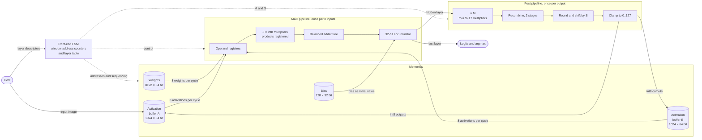

# suanpan (算盘)

[中文版](README.zh-CN.md)

[](https://github.com/lai3d/suanpan/actions/workflows/ci.yml)

An AI chip designed from scratch, one stage at a time. The name is the Chinese
abacus: like its beads, the core of the chip multiplies and accumulates.

The plan has three stages: RTL and simulation, FPGA, then ASIC tapeout. What
each one means, costs and proves is in [docs/three-stages.md](docs/three-stages.md)
([中文版](docs/three-stages.zh-CN.md)).

**Stage 1 (done): RTL + simulation.** A from-scratch hardware accelerator
for INT8 convolutional and fully-connected inference, verified bit-exactly in
simulation against an integer golden model on MNIST.

## Status

Two networks run on the same hardware; only the memory images differ.

| | CNN (default) | MLP |
|---|---|---|
| Layers | conv 4×4/2 ×8 → conv 3×3/2 ×16 → fc 10 | fc 64 → fc 10 |
| Accuracy, float / INT8 | 98.61% / 98.59% | 97.52% / 97.48% |
| Weights | 7.2 KB | 50.8 KB |
| RTL vs golden model, 10,000 images | 0 mismatches | 0 mismatches |
| Clock cycles per inference | 11,352 | 6,377 |

Accuracy is on the 10,000-image MNIST test set, post-training quantization.
"0 mismatches" means all 100,000 logits and 10,000 predicted classes match.
A third network, `stress`, exists only to exercise hardware corner cases
(one-word windows, a padded single-channel input, odd layer widths) and is
checked the same way.

An output value costs exactly as many cycles as its window has memory words.
Everything after address generation is a feed-forward pipeline, so the front
end issues consecutive outputs back to back. Of the CNN's 11,352 cycles,
11,312 are multiply-accumulate.

The CNN's input is stored space-to-depth: each 2×2 block of pixels becomes one
4-channel pixel, so the 28×28 image is a 14×14×4 tensor. That is a pure
rearrangement. A 2×2 convolution on it is the same arithmetic as a 4×4
stride-2 convolution on the image, but its window is 4 memory words.

## Synthesis estimate (SKY130, pre-layout)

Yosys + ABC onto the open `sky130_fd_sc_hd` library, typical corner (1.8 V,
25 °C), no wire load. Memories are black-boxed and counted separately.

| Metric | Value |
|---|---|
| Standard cells | 18,659 combinational + 1,678 flip-flops |
| Logic area | 142,011 µm² (0.142 mm²), 32% of it sequential |
| Longest combinational path | 2.6 ns → roughly 380 MHz |
| Time per inference at that clock | CNN ≈ 30 µs, MLP ≈ 17 µs |
| Memory as configured | 659 kbit: weights 524 kbit, 2 × 66 kbit activations, 4 kbit bias |
| Memory the CNN alone needs | 102 kbit: weights 66 kbit, 2 × 16 kbit activations, 4 kbit bias |

These are logic-synthesis estimates, not sign-off numbers: there is no
placement, routing, clock tree or SRAM macro yet (SRAM access time may well
set the real clock), and power is not estimated. Memory, not logic, will
dominate chip area by a wide margin.

The longest path is one of the 9×17 multipliers in the requantization
pipeline.

### History

Every row was re-synthesized with the current flow, so the columns are
comparable.

| Version | Path | Logic area | MLP cycles | CNN cycles |
|---|---|---|---|---|
| 1. Single-cycle requantization, adder chain in the dot product | 5.2 ns | 101,378 µm² | 6,929 | n/a |
| 2. 3-stage MAC pipeline, multi-cycle requantization | 3.1 ns | 87,594 µm² | 7,389 | n/a |
| 3. Convolution (window addressing, wider layer table) | 3.0 ns | 102,592 µm² | 7,389 | 47,072 |
| 4. Post unit overlaps the next output | 3.0 ns | 108,403 µm² | 6,460 | 20,051 |
| 5. Current: feed-forward post pipeline, back-to-back outputs | 2.6 ns | 142,011 µm² | 6,377 | 11,352 |

What each step changed in the RTL:

- **2**: the dot product registers its 8 products and sums them in a balanced
  tree; `acc × M` uses one 9×17 multiplier over four cycles instead of a 32×17
  multiplier, with round / shift / clamp in their own cycles; layer parameters
  are latched once per layer; the adders are shared explicitly.
- **3**: no new datapath, only address counters and a wider layer table
  (4 × 144 bits of registers).
- **4**: the controller is split into a front end (addresses) and a post unit
  (requantize + write back) that run concurrently; the bias becomes the
  accumulator's initial value instead of a separate add.
- **5**: the post unit becomes a pipeline that accepts a new sum every cycle
  (four 9×17 multipliers instead of one reused four times), which removes the
  minimum spacing between outputs and the set-up cycle before each one; memory
  outputs are registered before the multipliers. The CNN's drop from 20,051
  cycles also needs the space-to-depth input, which is a model change: with
  the old network this hardware takes 18,112.

Step 5 trades area for speed: 31% more logic for a 13% shorter clock period
and, on the CNN, 43% fewer cycles.

A note on the flow. Yosys and ABC defaults are area-oriented and turn adders
into ripple-carry chains, which made the very first estimate read 12.2 ns and
later made results jump between revisions for no RTL reason. `syn/synth.sh`
maps adders to Kogge-Stone, skips Yosys' built-in generic ABC pass (`-noabc`)
and uses a delay-oriented ABC script (`syn/abc.script`).

## FPGA (stage 2, in progress)

`fpga/tangnano20k` is a self-contained demo for the Sipeed Tang Nano 20K
(Gowin GW2AR-18): on power-up it loads one MNIST digit from ROM into the
accelerator, runs the CNN, and shows the predicted class on the LEDs. A button
press runs it again.

It builds with the open-source flow (Yosys, nextpnr-himbaechel, gowin_pack):

| Metric | Value |
|---|---|
| Timing | 94 MHz achievable, 27 MHz required (board oscillator) |
| LUT4 | 2,338 of 20,736 (11%) |
| Flip-flops | 1,340 of 15,552 (8%) |
| Block RAM | 14 of 46 (30%) |
| DSP multipliers | 8 × 9×9 and 4 × 18×18 |

What has and has not been checked:

- The board wrapper passes in RTL simulation (`make fpga-sim`).
- The placed-and-routed netlist passes in gate-level simulation
  (`make fpga-gatesim`), using behavioural models of the Gowin block RAM and
  multipliers written for this repo. Those models follow Yosys' own mapping
  conventions; they are not vendor models.
- **It has not been run on a physical board.** Pin numbers come from Sipeed's
  example repository; the button's polarity is unverified, so the wrapper
  re-runs on any change of the button.

The build restricts block RAMs to 18-bit data. In the 36-bit single-port mode
nextpnr reports hold violations on every such block, for every placement;
whether those are real or a timing-model artifact is not established.

The numbers are for the CNN-only memory configuration (1,024 weight words,
256-word activation buffers). The full configuration used for the ASIC
estimate has not been placed and routed.

## Architecture



The two activation buffers ping-pong: even layers read A and write B, odd
layers read B and write A.

### How convolution works here

There is no separate convolution engine. Feature maps are stored HWC with the
channel count padded to a multiple of 8, so one pixel is a whole number of
64-bit words and each kernel row of a window is a contiguous run of words.
An output value is then the same dot product as before, read through a
pointer that walks `row_len` words, skips `row_skip` words to the next image
row, and repeats for `n_rows` rows. The window origin advances by `step_x`
words per output column and `step_y` per output row, which is how stride is
expressed. A fully-connected layer is the special case of one output pixel
whose single kernel row covers the whole input.

Limits: no padding (valid convolutions only), no pooling (use stride),
convolution output channels must be a multiple of 8, and one requantization
scale per layer rather than per channel.

### Files

- `rtl/dot_unit.sv` — 8-lane signed 8×8 dot product (the compute core):
  registered multipliers feeding a balanced adder tree.
- `rtl/nn_accel.sv` — front-end FSM with window addressing, MAC pipeline,
  post pipeline (requantization, write-back, argmax). The network is a table
  of layer descriptors written by the host, so a different network only needs
  new memory images, not new RTL.
- `rtl/sram_sp.sv` — synchronous-read memory (SRAM macro / block RAM).
- `model/train.py` — numpy training, quantization, memory-image export, and
  the bit-exact integer reference model.
- `tb/tb_nn_accel.sv` — self-checking testbench.
- `fpga/` — Tang Nano 20K demo, build script and gate-level simulation models.

## Run

Requires `iverilog`, `verilator` (plus `yosys` for synthesis) and Python with
`numpy` (`python3 -m venv .venv && .venv/bin/pip install -r requirements.txt`).

```bash
make model      # downloads MNIST, trains, writes build/cnn/*.hex
make sim        # 100 images, Icarus Verilog
make sim-full   # all 10,000 images, Verilator
make wave       # one image, dumps build/tb.vcd
make lint
make synth      # SKY130 logic synthesis (needs yosys), PERIOD=<ps>

make fpga-sim      # Tang Nano 20K wrapper, RTL simulation
make fpga          # synthesis, place and route -> build/fpga/top.fs
make fpga-gatesim  # simulate the routed netlist
```

The `fpga` targets need `nextpnr-himbaechel` and `gowin_pack` on `PATH`; the
[OSS CAD Suite](https://github.com/YosysHQ/oss-cad-suite-build) provides both.

Add `ARCH=mlp` (or `ARCH=stress`) to `model`, `sim`, `sim-full` or `wave` to
use another network instead of the default CNN.

## License

Apache-2.0. See [LICENSE](LICENSE).
