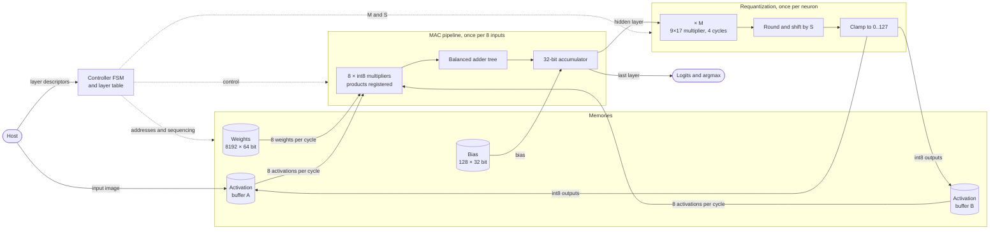

# suanpan (算盘)

An AI chip designed from scratch, one stage at a time. The name is the Chinese
abacus: like its beads, the core of the chip multiplies and accumulates.

**Stage 1 (current): RTL + simulation.** A from-scratch hardware accelerator for fully-connected INT8 inference,
verified bit-exactly in simulation against an integer golden model on MNIST.

## Status

| Check | Result |
|---|---|
| Model | 784 → 64 (ReLU) → 10, INT8 weights, post-training quantized |
| Accuracy (float / INT8) | 97.52% / 97.48% on the 10,000-image MNIST test set |
| RTL vs golden model | 100,000 logits + 10,000 classes, 0 mismatches (Verilator) |
| Latency | 7,389 clock cycles per inference |

## Synthesis estimate (SKY130, pre-layout)

Yosys + ABC onto the open `sky130_fd_sc_hd` library, typical corner (1.8 V,
25 °C), no wire load. Memories are black-boxed and counted separately.

| Metric | Value |
|---|---|
| Standard cells | 8,699 combinational + 857 flip-flops |
| Logic area | 70,249 µm² (0.070 mm²), 33% of it sequential |
| Dot-product core alone | 27,722 µm² (39% of logic) |
| Longest combinational path | 4.0 ns → roughly 250 MHz |
| Time per inference at that clock | 7,389 cycles × 4.0 ns ≈ 30 µs |
| Memory | 545 kbit: weights 524 kbit, 2 × 8 kbit activations, 4 kbit bias |

These are logic-synthesis estimates, not sign-off numbers: there is no
placement, routing, clock tree or SRAM macro yet (SRAM access time may well
set the real clock), and power is not estimated. Memory, not logic, will
dominate chip area by a wide margin.

### Timing history

| Version | Path | Cycles | Per inference | Logic area |
|---|---|---|---|---|
| Single-cycle requantization, adder chain in the dot product | 5.4 ns | 6,929 | 37 µs | 84,106 µm² |
| Current: 3-stage MAC pipeline, multi-cycle requantization | 4.0 ns | 7,389 | 30 µs | 70,249 µm² |

Both rows use the same synthesis flow. What changed in the RTL:

- the dot product registers its 8 products, then sums them in a balanced tree;
- `acc × M` uses one 9×17 multiplier over four cycles instead of a 32×17
  multiplier, and round / shift / clamp each get their own cycle;
- layer parameters are latched once per layer instead of being muxed from the
  layer table on every path;
- accumulate + bias share one explicit 32-bit adder, and the requantization
  steps share one explicit 48-bit adder.

A note on the flow: Yosys' default adder mapping and ABC's default script
produce ripple-carry chains, which made a first estimate read 12.2 ns.
`syn/synth.sh` maps adders to Kogge-Stone and uses a delay-oriented ABC script
(`syn/abc.script`); most of the drop from 12.2 ns came from that, not from RTL.

## Architecture



The two activation buffers ping-pong: even layers read A and write B, odd
layers read B and write A.

- `rtl/dot_unit.sv` — 8-lane signed 8×8 dot product (the compute core):
  registered multipliers feeding a balanced adder tree.
- `rtl/nn_accel.sv` — controller FSM, MAC pipeline, requantization, argmax.
  The network is a table of layer descriptors in config memory, so a different
  MLP only needs new memory images, not new RTL.
- `rtl/sram_sp.sv` — synchronous-read memory (SRAM macro / block RAM).
- `model/train.py` — numpy training, quantization, memory-image export, and the
  bit-exact integer reference model.
- `tb/tb_nn_accel.sv` — self-checking testbench.

## Run

Requires `iverilog`, `verilator` (plus `yosys` for synthesis) and Python with `numpy` (`python3 -m venv .venv && .venv/bin/pip install -r requirements.txt`).

```bash
make model      # downloads MNIST, trains, writes build/mem/*.hex
make sim        # 100 images, Icarus Verilog
make sim-full   # all 10,000 images, Verilator
make wave       # one image, dumps build/tb.vcd
make lint
make synth      # SKY130 logic synthesis (needs yosys), PERIOD=<ps>
```

## License

Apache-2.0. See [LICENSE](LICENSE).
