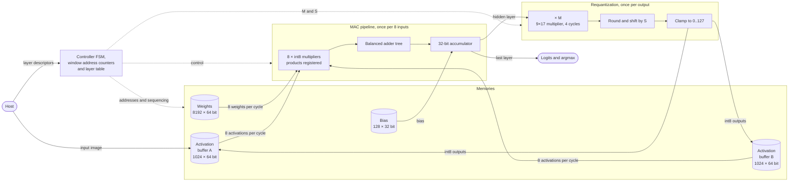

# suanpan (算盘)

[](https://github.com/lai3d/suanpan/actions/workflows/ci.yml)

An AI chip designed from scratch, one stage at a time. The name is the Chinese
abacus: like its beads, the core of the chip multiplies and accumulates.

**Stage 1 (current): RTL + simulation.** A from-scratch hardware accelerator
for INT8 convolutional and fully-connected inference, verified bit-exactly in
simulation against an integer golden model on MNIST.

## Status

Two networks run on the same hardware; only the memory images differ.

| | CNN (default) | MLP |
|---|---|---|
| Layers | conv 3×3/2 ×8 → conv 3×3/2 ×16 → fc 10 | fc 64 → fc 10 |
| Accuracy, float / INT8 | 98.51% / 98.48% | 97.52% / 97.48% |
| Weights | 7.5 KB | 50.8 KB |
| RTL vs golden model, 10,000 images | 0 mismatches | 0 mismatches |
| Clock cycles per inference | 47,072 | 7,389 |

Accuracy is on the 10,000-image MNIST test set, post-training quantization.
"0 mismatches" means all 100,000 logits and 10,000 predicted classes match.

The CNN is more accurate with a seventh of the weights, but takes six times as
many cycles. Two known reasons, both left for later:

- per-output overhead: each output value spends about 15 cycles on pipeline
  drain, bias and requantization. The CNN has 1,938 outputs, so that is 62% of
  its cycles; the MAC loop itself is only 18,072.
- the single-channel input is padded to 8 channels, so 7 of the 8 multipliers
  in the first layer multiply zeros.

## Synthesis estimate (SKY130, pre-layout)

Yosys + ABC onto the open `sky130_fd_sc_hd` library, typical corner (1.8 V,
25 °C), no wire load. Memories are black-boxed and counted separately.

| Metric | Value |
|---|---|
| Standard cells | 10,109 combinational + 1,172 flip-flops |
| Logic area | 86,135 µm² (0.086 mm²), 38% of it sequential |
| Longest combinational path | 3.7 ns → roughly 270 MHz |
| Time per inference at that clock | CNN ≈ 176 µs, MLP ≈ 28 µs |
| Memory as configured | 659 kbit: weights 524 kbit, 2 × 66 kbit activations, 4 kbit bias |
| Memory the CNN alone needs | 201 kbit (weights fit in 66 kbit) |

These are logic-synthesis estimates, not sign-off numbers: there is no
placement, routing, clock tree or SRAM macro yet (SRAM access time may well
set the real clock), and power is not estimated. Memory, not logic, will
dominate chip area by a wide margin.

### History

| Version | Path | Logic area | MLP cycles |
|---|---|---|---|
| Single-cycle requantization, adder chain in the dot product | 5.4 ns | 84,106 µm² | 6,929 |
| 3-stage MAC pipeline, multi-cycle requantization | 4.0 ns | 70,249 µm² | 7,389 |
| Current: + convolution (window addressing, wider layer table) | 3.7 ns | 86,135 µm² | 7,389 |

All rows use the same synthesis flow. The timing work changed the RTL so that:

- the dot product registers its 8 products, then sums them in a balanced tree;
- `acc × M` uses one 9×17 multiplier over four cycles instead of a 32×17
  multiplier, and round / shift / clamp each get their own cycle;
- layer parameters are latched once per layer instead of being muxed from the
  layer table on every path;
- accumulate + bias share one explicit 32-bit adder, and the requantization
  steps share one explicit 48-bit adder.

Convolution added no datapath, only address counters and a wider layer table
(4 × 144 bits of registers, most of the area increase). The difference between
4.0 and 3.7 ns is within the noise of the mapper, not an improvement.

A note on the flow: Yosys' default adder mapping and ABC's default script
produce ripple-carry chains, which made a first estimate read 12.2 ns.
`syn/synth.sh` maps adders to Kogge-Stone and uses a delay-oriented ABC script
(`syn/abc.script`); most of the drop from 12.2 ns came from that, not from RTL.

## Architecture



The two activation buffers ping-pong: even layers read A and write B, odd
layers read B and write A.

### How convolution works here

There is no separate convolution engine. Feature maps are stored HWC with the
channel count padded to a multiple of 8, so one pixel is a whole number of
64-bit words and each kernel row of a window is a contiguous run of words.
An output value is then the same dot product as before, read through a
pointer that walks `row_len` words, skips `row_skip` words to the next image
row, and repeats for `n_rows` rows. The window origin advances by `step_x`
words per output column and `step_y` per output row, which is how stride is
expressed. A fully-connected layer is the special case of one output pixel
whose single kernel row covers the whole input.

Limits: no padding (valid convolutions only), no pooling (use stride),
convolution output channels must be a multiple of 8, and one requantization
scale per layer rather than per channel.

- `rtl/dot_unit.sv` — 8-lane signed 8×8 dot product (the compute core):
  registered multipliers feeding a balanced adder tree.
- `rtl/nn_accel.sv` — controller FSM, window addressing, MAC pipeline,
  requantization, argmax. The network is a table of layer descriptors written
  by the host, so a different network only needs new memory images, not new RTL.
- `rtl/sram_sp.sv` — synchronous-read memory (SRAM macro / block RAM).
- `model/train.py` — numpy training (CNN or MLP), quantization, memory-image
  export, and the bit-exact integer reference model.
- `tb/tb_nn_accel.sv` — self-checking testbench.

## Run

Requires `iverilog`, `verilator` (plus `yosys` for synthesis) and Python with `numpy` (`python3 -m venv .venv && .venv/bin/pip install -r requirements.txt`).

```bash
make model      # downloads MNIST, trains, writes build/cnn/*.hex
make sim        # 100 images, Icarus Verilog
make sim-full   # all 10,000 images, Verilator
make wave       # one image, dumps build/tb.vcd
make lint
make synth      # SKY130 logic synthesis (needs yosys), PERIOD=<ps>
```

Add `ARCH=mlp` to `model`, `sim`, `sim-full` or `wave` to use the MLP instead
of the default CNN.

## License

Apache-2.0. See [LICENSE](LICENSE).
