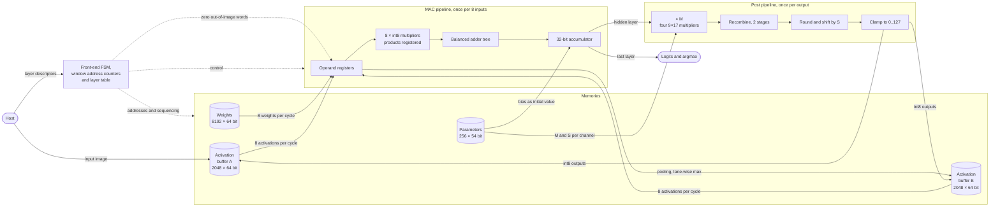

# suanpan (算盘)

[中文版](README.zh-CN.md)

[](https://github.com/lai3d/suanpan/actions/workflows/ci.yml)

An AI chip designed from scratch, one stage at a time. The name is the Chinese
abacus: like its beads, the core of the chip multiplies and accumulates.

The plan has three stages: RTL and simulation, FPGA, then ASIC tapeout. What
each one means, costs and proves is in [docs/three-stages.md](docs/three-stages.md)
([中文版](docs/three-stages.zh-CN.md)).

**Stage 1 (done): RTL + simulation.** A from-scratch hardware accelerator
for INT8 inference with convolution, max pooling and fully-connected layers, verified bit-exactly in
simulation against an integer golden model on MNIST.

## Status

Two networks run on the same hardware; only the memory images differ.

| | CNN (default) | MLP |
|---|---|---|
| Layers | conv 4×4/2 ×8 → conv 3×3/2 ×16 → fc 10 | fc 64 → fc 10 |
| Accuracy, float / INT8 | 98.61% / 98.60% | 97.52% / 97.49% |
| Weights | 7.2 KB | 50.8 KB |
| RTL vs golden model, 10,000 images | 0 mismatches | 0 mismatches |
| Clock cycles per inference | 11,355 | 6,379 |

Accuracy is on the 10,000-image MNIST test set, post-training quantization.
"0 mismatches" means all 100,000 logits and 10,000 predicted classes match.
A third network, `stress`, exists only to exercise hardware corner cases
(padded convolutions, max pooling, one-word windows, a single-channel input,
odd layer widths) and is checked the same way.

An output value costs exactly as many cycles as its window has memory words.
Everything after address generation is a feed-forward pipeline, so the front
end issues consecutive outputs back to back. Of the CNN's 11,355 cycles,
11,312 are multiply-accumulate.

The CNN's input is stored space-to-depth: each 2×2 block of pixels becomes one
4-channel pixel, so the 28×28 image is a 14×14×4 tensor. That is a pure
rearrangement. A 2×2 convolution on it is the same arithmetic as a 4×4
stride-2 convolution on the image, but its window is 4 memory words.

## Bring your own model

`tools/compile.py` turns an ONNX model, as exported by PyTorch or another
framework, into the accelerator's memory images and a set of golden vectors
for the testbench.

```bash
python tools/compile.py examples/lenet5.onnx --out build/lenet5 --data mnist
make sim-full MEM=build/lenet5
```

`examples/lenet5.onnx` is the classic LeNet-5, trained in PyTorch by
`examples/train_lenet5.py` with no knowledge of this hardware:

| LeNet-5 from PyTorch | |
|---|---|
| Layers | conv 5×5 pad 2 ×6 → pool → conv 5×5 ×16 → pool → fc 120 → fc 84 → fc 10 |
| Accuracy, float / INT8 | 98.92% / 98.89% |
| INT8 picks the float model's class | 99.93% of test images |
| RTL vs golden model, 10,000 images | 0 mismatches |
| Weights | 63.8 KB |
| Clock cycles per inference | 205,247 |

`examples/cifar10.onnx` is a small CNN for CIFAR-10, also trained in PyTorch
(`examples/train_cifar10.py`): colour images, batch normalization, three
padded convolutions.

| CIFAR-10 CNN from PyTorch | |
|---|---|
| Layers | (conv 3×3 pad 1 → BN → ReLU → pool) × 3 with 16 / 32 / 64 channels → fc 10 |
| Accuracy, float / INT8 | 81.13% / 80.54% |
| INT8 picks the float model's class | 96.64% of test images |
| RTL vs golden model, 10,000 images | 0 mismatches |
| Weights | 34.4 KB |
| Clock cycles per inference | 447,318 |

```bash
python tools/compile.py examples/cifar10.onnx --out build/cifar10 --data cifar10
make sim-full MEM=build/cifar10 N_FULL=1000
```

Quantization costs 0.6 points here, against 0.03 for LeNet-5 on MNIST. A third
of the cycles go to the first layer, where the 3 colour channels are padded to
8 and five of the eight multipliers are idle.

What the compiler does:

- **Imports** a chain of Conv, BatchNormalization (folded into the
  convolution), Relu, MaxPool, Flatten and Gemm / MatMul + Add.
- **Rewrites** the network without changing what it computes: convolution
  channel counts are rounded up to a multiple of 8 with all-zero filters
  (LeNet's 6 becomes 8); a leading fully-connected layer gets a densely packed
  input; an even-sized stride-2 first convolution is moved onto a
  space-to-depth input.
- **Quantizes** to INT8 after training, using calibration images.
- **Checks** the result against the hardware's capacity and refuses, with a
  message naming the limit, when the network does not fit.
- **Writes** the memory images plus the outputs of a bit-exact integer model,
  which is what the RTL is compared against.

Requirements on the model: one input, a single chain of layers, images scaled
to [0, 1] with no other normalization, ReLU after every hidden convolution or
fully-connected layer, raw logits at the end. Anything else is rejected with
an explanation rather than compiled approximately.

The compiler is tested against itself: the networks trained by
`model/train.py` are exported to ONNX and compiled back, and all nine output
files must be byte-identical (`make test-compiler`).

## Synthesis estimate (SKY130, pre-layout)

Yosys + ABC onto the open `sky130_fd_sc_hd` library, typical corner (1.8 V,
25 °C), no wire load. Memories are black-boxed and counted separately.

| Metric | Value |
|---|---|
| Standard cells | 19,987 combinational + 1,531 flip-flops |
| Logic area | 142,457 µm² (0.142 mm²), 27% of it sequential |
| Longest combinational path | 2.6 ns → roughly 380 MHz |
| Time per inference at that clock | MNIST CNN ≈ 30 µs, LeNet-5 ≈ 0.54 ms, CIFAR-10 CNN ≈ 1.2 ms |
| Memory as configured | 802 kbit: weights 524 kbit, 2 × 131 kbit activations, 14 kbit parameters, 1 kbit layer table |
| Memory the CNN alone needs | 107 kbit: weights 66 kbit, 2 × 16 kbit activations, 7 kbit parameters, 1 kbit layer table |

These are logic-synthesis estimates, not sign-off numbers: there is no
placement, routing, clock tree or SRAM macro yet (SRAM access time may well
set the real clock), and power is not estimated. Memory, not logic, will
dominate chip area by a wide margin.

The longest path is one of the 9×17 multipliers in the requantization
pipeline.

### History

Every row was re-synthesized with the current flow, so the columns are
comparable.

| Version | Path | Logic area | MLP cycles | CNN cycles |
|---|---|---|---|---|
| 1. Single-cycle requantization, adder chain in the dot product | 5.2 ns | 101,378 µm² | 6,929 | n/a |
| 2. 3-stage MAC pipeline, multi-cycle requantization | 3.1 ns | 87,594 µm² | 7,389 | n/a |
| 3. Convolution (window addressing, wider layer table) | 3.0 ns | 102,592 µm² | 7,389 | 47,072 |
| 4. Post unit overlaps the next output | 3.0 ns | 108,403 µm² | 6,460 | 20,051 |
| 5. Feed-forward post pipeline, back-to-back outputs | 2.6 ns | 142,011 µm² | 6,377 | 11,352 |
| 6. Padding, max pooling, per-channel requantization | 2.6 ns | 141,917 µm² | 6,379 | 11,355 |
| 7. Current: larger memories (2,048-word buffers, 256 parameter words) | 2.6 ns | 142,457 µm² | 6,379 | 11,355 |

What each step changed in the RTL:

- **2**: the dot product registers its 8 products and sums them in a balanced
  tree; `acc × M` uses one 9×17 multiplier over four cycles instead of a 32×17
  multiplier, with round / shift / clamp in their own cycles; layer parameters
  are latched once per layer; the adders are shared explicitly.
- **3**: no new datapath, only address counters and a wider layer table
  (4 × 144 bits of registers).
- **4**: the controller is split into a front end (addresses) and a post unit
  (requantize + write back) that run concurrently; the bias becomes the
  accumulator's initial value instead of a separate add.
- **5**: the post unit becomes a pipeline that accepts a new sum every cycle
  (four 9×17 multipliers instead of one reused four times), which removes the
  minimum spacing between outputs and the set-up cycle before each one; memory
  outputs are registered before the multipliers. The CNN's drop from 20,051
  cycles also needs the space-to-depth input, which is a model change: with
  the old network this hardware takes 18,112.

- **6**: out-of-image words are zeroed as they are read (padding); a lane-wise
  maximum path writes pooled words directly; bias, multiplier and shift come
  from one parameter word per output channel and travel with the output. The
  layer table moves from registers to a small memory and grows to 8 entries,
  which is why the logic area does not rise.

Step 5 trades area for speed: 31% more logic for a 13% shorter clock period
and, on the CNN, 43% fewer cycles.

A note on the flow. Yosys and ABC defaults are area-oriented and turn adders
into ripple-carry chains, which made the very first estimate read 12.2 ns and
later made results jump between revisions for no RTL reason. `syn/synth.sh`
maps adders to Kogge-Stone, skips Yosys' built-in generic ABC pass (`-noabc`)
and uses a delay-oriented ABC script (`syn/abc.script`).

## FPGA (stage 2, in progress)

`fpga/tangnano20k` is a self-contained demo for the Sipeed Tang Nano 20K
(Gowin GW2AR-18): on power-up it loads one test image from ROM into the
accelerator, runs the network, and shows the predicted class on the LEDs. A
button press runs it again. Over the board's USB serial port a host can also
send any image and get back the class and all ten logits, which allows the
same bit-exact comparison on hardware that the testbench makes in simulation.

The design is built around one compiled network. The compiler writes a small
header (`net_params.vh`) with that network's exact memory sizes, and the
memories are made that deep and no deeper, instead of the next power of two:

```bash
make fpga                       # the default MNIST CNN
make fpga NET=build/cifar10     # any compiled network
```

All three example networks fit the board with the open-source flow (Yosys,
nextpnr-himbaechel, gowin_pack):

| | MNIST CNN | LeNet-5 | CIFAR-10 CNN |
|---|---|---|---|
| Block RAM (of 46) | 14 | 41 | 35 |
| LUT4 (of 20,736) | 2,787 | 3,041 | 3,056 |
| Timing (27 MHz required) | 82 MHz | 82 MHz | 81 MHz |
| Routed netlist in gate-level simulation | pass | not run | pass |

Sizing matters: with power-of-two memories the CIFAR-10 network needs about
48 block RAMs and does not fit.

What has and has not been checked:

- The board wrapper passes in RTL simulation (`make fpga-sim`). The testbench
  plays the host: it pings, sends images over the UART and checks the class
  and every logit, and checks that a stalled command is dropped.
- The placed-and-routed netlist passes in gate-level simulation
  (`make fpga-gatesim`), using behavioural models of the Gowin block RAM and
  multipliers written for this repo. Those models follow Yosys' own mapping
  conventions; they are not vendor models.
- **It has not been run on a physical board.** Pin numbers come from Sipeed's
  example repository; the button's polarity is unverified, so the wrapper
  re-runs on any change of the button. `tools/host.py` has only been run
  without a board.

UART protocol (8N1, 115200 baud by default; `BAUD=<rate> make fpga` to change):

| Host sends | Board replies |
|---|---|
| `P` | `K` |
| `I` + 196 input words, 8 bytes each, little-endian | class (1 byte) + 10 logits, int32 little-endian |

A command that stalls for 125 ms is dropped, so a lost byte cannot leave the
link out of step.

The build restricts block RAMs to 18-bit data. In the 36-bit single-port mode
nextpnr reports hold violations on every such block, for every placement;
whether those are real or a timing-model artifact is not established.

## Architecture



The two activation buffers ping-pong: even layers read A and write B, odd
layers read B and write A.

### How layers are executed

There is no separate convolution engine. Feature maps are stored HWC with the
channel count padded to a multiple of 8, so one pixel is a whole number of
64-bit words. A window is `kh` rows of `kw` pixels; the read pointer visits
`rd_words` words of each pixel, then moves `pix_step` to the next pixel or
`row_step` to the next kernel row. The window origin advances by `step_x`
words per output column and `step_y` per output row, which is how stride is
expressed.

- **Convolution** reads every word of each window pixel and feeds the
  multiply-accumulate pipeline.
- **Fully connected** is the special case of one output pixel whose single
  "pixel" is the whole input.
- **Padding** is not stored. The window origin starts outside the image, and
  any word whose pixel lies outside the image is replaced by zero as it is
  read.
- **Max pooling** bypasses the multipliers. Channels are packed eight to a
  word, so the maximum is taken on whole words, eight lanes at a time, and the
  result is written back directly.
- **Requantization** uses a multiplier and shift per output channel, stored
  next to the bias. The last layer keeps one scale for all outputs, because
  its raw sums are compared with each other.

Limits: pooling is max only, a network has at most 8 layers, and convolution
outputs are written a word at a time, so their channel count is a multiple of
8 (the compiler pads it).

### Files

- `rtl/dot_unit.sv` — 8-lane signed 8×8 dot product (the compute core):
  registered multipliers feeding a balanced adder tree.
- `rtl/nn_accel.sv` — front-end FSM with window addressing, MAC pipeline,
  post pipeline (requantization, write-back, argmax). The network is a table
  of layer descriptors written by the host, so a different network only needs
  new memory images, not new RTL.
- `rtl/sram_sp.sv` — synchronous-read memory (SRAM macro / block RAM).
- `model/nnc.py` — the compiler core: rewrites, quantization, the bit-exact
  integer reference model, memory-image export.
- `model/onnx_io.py`, `tools/compile.py` — ONNX front end and command line.
- `model/train.py` — numpy training of the built-in networks.
- `model/datasets.py` — MNIST and CIFAR-10 loaders.
- `examples/` — LeNet-5 and a CIFAR-10 CNN trained in PyTorch, with their
  ONNX files.
- `tests/test_compiler.py` — compiler tests.
- `tb/tb_nn_accel.sv` — self-checking testbench.
- `fpga/` — Tang Nano 20K demo, UART, build script and gate-level simulation
  models.
- `tools/host.py` — host side of the UART interface.

## Run

Requires `iverilog`, `verilator` (plus `yosys` for synthesis) and Python with
`numpy` and `onnx` (`python3 -m venv .venv && .venv/bin/pip install -r requirements.txt`).

```bash
make model      # downloads MNIST, trains, writes build/cnn/*.hex
make sim        # 100 images, Icarus Verilog
make sim-full   # all 10,000 images, Verilator
make wave       # one image, dumps build/tb.vcd
make lint
make synth      # SKY130 logic synthesis (needs yosys), PERIOD=<ps>
make test-compiler

make fpga-sim      # Tang Nano 20K wrapper, RTL simulation
make fpga          # synthesis, place and route -> build/fpga/top.fs
                   # (NET=<compiled network dir>, default build/cnn)
make fpga-gatesim  # simulate the routed netlist
make fpga-load     # load the bitstream into SRAM (lost at power-off)
make fpga-flash    # write the bitstream to the board's flash

python tools/host.py --port <serial device> ping
python tools/host.py --port <serial device> run --n 10000
```

The `fpga` targets need `nextpnr-himbaechel` and `gowin_pack` on `PATH`; the
[OSS CAD Suite](https://github.com/YosysHQ/oss-cad-suite-build) provides both.

Add `ARCH=mlp` (or `ARCH=stress`) to `model`, `sim`, `sim-full` or `wave` to
use another network instead of the default CNN.

## License

Apache-2.0. See [LICENSE](LICENSE).
