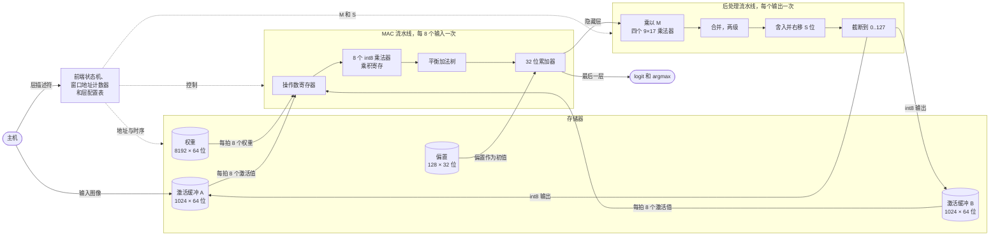

# suanpan（算盘）

[English](README.md)

[](https://github.com/lai3d/suanpan/actions/workflows/ci.yml)

一颗从头设计的 AI 芯片，一个层次一个层次地做。名字取自算盘：芯片的核心和算珠一样，做的就是乘和累加。

计划分三个层次：RTL 与仿真、FPGA、流片。每一层是什么、花多少钱、能证明什么，见 [docs/three-stages.zh-CN.md](docs/three-stages.zh-CN.md)（[English](docs/three-stages.md)）。

**层次 1（已完成）：RTL + 仿真。** 一个从零写起的硬件加速器，支持 INT8 的卷积层和全连接层推理，在 MNIST 上与整数黄金模型做了逐位一致的仿真验证。

## 现状

同一套硬件上运行两个网络，区别只在存储镜像。

| | CNN（默认） | MLP |
|---|---|---|
| 结构 | conv 4×4/2 ×8 → conv 3×3/2 ×16 → fc 10 | fc 64 → fc 10 |
| 准确率，浮点 / INT8 | 98.61% / 98.59% | 97.52% / 97.48% |
| 权重 | 7.2 KB | 50.8 KB |
| RTL 对比黄金模型，10,000 张图 | 0 处不一致 | 0 处不一致 |
| 每次推理的时钟周期数 | 11,352 | 6,377 |

准确率在 MNIST 的 10,000 张测试图上测得，采用训练后量化。"0 处不一致"指全部 100,000 个 logit 和 10,000 个分类结果都相同。另有第三个网络 `stress`，只用来覆盖硬件的边界情况（只有一个字的窗口、补零的单通道输入、非 8 倍数的层宽），验证方式相同。

一个输出值花的周期数，正好等于它的窗口占多少个存储字。地址生成之后的部分全是前馈流水线，所以前端可以把相邻的输出一个接一个地发出去。CNN 的 11,352 个周期里，有 11,312 个是乘加。

CNN 的输入按 space-to-depth 方式存放：每个 2×2 像素块变成一个 4 通道的像素，28×28 的图就成了 14×14×4 的张量。这只是重新排列，没有任何计算。在它上面做 2×2 卷积，与在原图上做 4×4、步长 2 的卷积是同一套算术，但窗口只占 4 个存储字。

## 综合估算（SKY130，布局布线前）

用 Yosys + ABC 综合到开源的 `sky130_fd_sc_hd` 单元库，典型工艺角（1.8 V，25 °C），不计连线负载。存储器按黑盒处理，单独统计。

| 指标 | 数值 |
|---|---|
| 标准单元 | 18,659 个组合单元 + 1,678 个触发器 |
| 逻辑面积 | 142,011 µm²（0.142 mm²），其中 32% 是时序单元 |
| 最长组合路径 | 2.6 ns，约 380 MHz |
| 按此主频的单次推理时间 | CNN 约 30 µs，MLP 约 17 µs |
| 当前配置的存储 | 659 kbit：权重 524 kbit，激活缓冲 2 × 66 kbit，偏置 4 kbit |
| 只跑 CNN 所需的存储 | 102 kbit：权重 66 kbit，激活缓冲 2 × 16 kbit，偏置 4 kbit |

这些是逻辑综合阶段的估算，不是签核数据：还没有布局、布线、时钟树和 SRAM 宏（真实主频很可能由 SRAM 的读取时间决定），功耗也没有评估。主导芯片面积的会是存储器，而且差距很大，不是逻辑。

最长路径是重量化流水线里的一个 9×17 乘法器。

### 演进历史

每一行都用当前的综合流程重新跑过，所以各列可以直接比较。

| 版本 | 路径 | 逻辑面积 | MLP 周期数 | CNN 周期数 |
|---|---|---|---|---|
| 1. 单周期重量化，点积里是加法链 | 5.2 ns | 101,378 µm² | 6,929 | 不适用 |
| 2. 三级 MAC 流水，多周期重量化 | 3.1 ns | 87,594 µm² | 7,389 | 不适用 |
| 3. 卷积（窗口寻址，更宽的层配置表） | 3.0 ns | 102,592 µm² | 7,389 | 47,072 |
| 4. 后处理单元与下一个输出并行 | 3.0 ns | 108,403 µm² | 6,460 | 20,051 |
| 5. 当前：前馈的后处理流水线，输出背靠背发出 | 2.6 ns | 142,011 µm² | 6,377 | 11,352 |

每一步在 RTL 上改了什么：

- **2**：点积单元先把 8 个乘积寄存一拍，再用平衡加法树求和；`acc × M` 从一个 32×17 乘法器改成一个 9×17 乘法器分四拍完成，舍入、移位、截断各占一拍；层参数每层锁存一次；加法器显式共享。
- **3**：没有新增数据通路，只加了地址计数器和更宽的层配置表（4 × 144 位寄存器）。
- **4**：控制器拆成并行运行的前端（发地址）和后处理单元（重量化加写回）；偏置变成累加器的初值，不再单独做一次加法。
- **5**：后处理单元改成每拍都能接收一个新结果的流水线（四个 9×17 乘法器，而不是一个乘法器复用四次），于是输出之间的最小间隔和每个输出前的准备周期都取消了；存储器的输出先寄存一拍再进乘法器。CNN 从 20,051 周期降下来还依赖 space-to-depth 输入，那是模型上的改动：换成旧网络，这套硬件需要 18,112 周期。

第 5 步是拿面积换速度：逻辑多了 31%，时钟周期短了 13%，CNN 的周期数少了 43%。

关于综合流程的一点说明。Yosys 和 ABC 的默认设置偏向面积，会把加法器变成逐位进位链，这让最初的估算读成了 12.2 ns，后来又让结果在 RTL 没有变化的情况下在各版本之间跳动。`syn/synth.sh` 把加法器映射成 Kogge-Stone 结构，跳过 Yosys 内置的通用 ABC 步骤（`-noabc`），并使用面向延迟的 ABC 脚本（`syn/abc.script`）。

## FPGA（层次 2，进行中）

`fpga/tangnano20k` 是面向 Sipeed Tang Nano 20K（高云 GW2AR-18）的独立演示工程：上电后把 ROM 里的一张 MNIST 数字图送进加速器，运行 CNN，把识别结果显示在 LED 上。按一下按键会重新运行。主机还可以通过板载的 USB 串口发送任意图像，取回分类结果和全部 10 个 logit，这样就能在真实硬件上做和仿真测试平台一样的逐位比对。

它用开源流程构建（Yosys、nextpnr-himbaechel、gowin_pack）：

| 指标 | 数值 |
|---|---|
| 时序 | 可达 98 MHz，要求 27 MHz（板载晶振） |
| LUT4 | 2,823 / 20,736（13%） |
| 触发器 | 1,655 / 15,552（10%） |
| 块 RAM | 14 / 46（30%） |
| DSP 乘法器 | 8 个 9×9，4 个 18×18 |

哪些验证过，哪些没有：

- 板级顶层通过了 RTL 仿真（`make fpga-sim`）。测试平台扮演主机：发连通性测试，通过串口发送图像并核对分类结果和每一个 logit，还验证了中途停顿的命令会被丢弃。
- 布局布线后的网表通过了门级仿真（`make fpga-gatesim`），用的是本仓库为高云块 RAM 和乘法器写的行为模型。这些模型遵循 Yosys 自身的映射约定，不是厂商模型。
- **它还没有在实体开发板上运行过。** 引脚编号取自 Sipeed 的示例仓库；按键的电平极性没有核实，所以顶层做成了按键状态一变化就重跑。`tools/host.py` 只在没有开发板的情况下运行过。

串口协议（8N1，默认 115200 波特率；用 `BAUD=<波特率> make fpga` 修改）：

| 主机发送 | 开发板回复 |
|---|---|
| `P` | `K` |
| `I` + 196 个输入字，每个 8 字节，小端 | 分类结果（1 字节）+ 10 个 logit，int32 小端 |

一条命令如果停顿超过 125 毫秒就会被丢弃，所以丢一个字节不会让链路一直错位。

构建时把块 RAM 限制在 18 位数据宽度。用 36 位单端口模式时，nextpnr 会对每一块这样的 RAM 报保持时间违例，而且与布局无关；这些违例是真实存在还是时序模型的问题，目前没有定论。

以上数字对应只跑 CNN 的存储配置（1,024 个权重字，256 字的激活缓冲）。ASIC 估算用的完整配置还没有做过布局布线。

## 架构



两个激活缓冲乒乓交替：偶数层读 A 写 B，奇数层读 B 写 A。

### 卷积在这里是怎么实现的

没有单独的卷积引擎。特征图按 HWC 存放，通道数补齐到 8 的倍数，这样一个像素正好占整数个 64 位字，卷积窗口的每一行在存储器里是连续的一段。一个输出值仍然是原来那种点积，只是通过一个读指针取数：走 `row_len` 个字，跳过 `row_skip` 个字到图像的下一行，重复 `n_rows` 行。窗口原点每个输出列前进 `step_x` 个字，每个输出行前进 `step_y` 个字，步长就是这样表达的。全连接层是特例：只有一个输出像素，唯一的一行"卷积核"覆盖整个输入。

限制：不支持填充（只有 valid 卷积），不支持池化（用步长代替），卷积的输出通道数必须是 8 的倍数，重量化系数每层一个而不是每通道一个。

### 文件

- `rtl/dot_unit.sv`：8 路有符号 8×8 点积（计算核心），寄存的乘法器接平衡加法树。
- `rtl/nn_accel.sv`：带窗口寻址的前端状态机、MAC 流水线、后处理流水线（重量化、写回、argmax）。网络是主机写入的一张层描述表，所以换一个网络只需要新的存储镜像，不需要改 RTL。
- `rtl/sram_sp.sv`：同步读存储器（对应 SRAM 宏或块 RAM）。
- `model/train.py`：numpy 训练、量化、存储镜像导出，以及逐位一致的整数参考模型。
- `tb/tb_nn_accel.sv`：自检测试平台。
- `fpga/`：Tang Nano 20K 演示工程、串口、构建脚本和门级仿真模型。
- `tools/host.py`：串口接口的主机端。

## 运行

需要 `iverilog`、`verilator`（综合还需要 `yosys`），以及带 `numpy` 的 Python（`python3 -m venv .venv && .venv/bin/pip install -r requirements.txt`）。

```bash
make model      # 下载 MNIST、训练、写出 build/cnn/*.hex
make sim        # 100 张图，Icarus Verilog
make sim-full   # 全部 10,000 张图，Verilator
make wave       # 一张图，输出波形 build/tb.vcd
make lint
make synth      # SKY130 逻辑综合（需要 yosys），PERIOD=<皮秒>

make fpga-sim      # Tang Nano 20K 顶层，RTL 仿真
make fpga          # 综合、布局布线，生成 build/fpga/top.fs
make fpga-gatesim  # 对布线后的网表做仿真
make fpga-load     # 把比特流载入 SRAM（断电丢失）
make fpga-flash    # 把比特流写入板上的闪存

python tools/host.py --port <串口设备> ping
python tools/host.py --port <串口设备> run --n 10000
```

`fpga` 相关目标需要 `PATH` 里有 `nextpnr-himbaechel` 和 `gowin_pack`，[OSS CAD Suite](https://github.com/YosysHQ/oss-cad-suite-build) 里两个都有。

给 `model`、`sim`、`sim-full` 或 `wave` 加上 `ARCH=mlp`（或 `ARCH=stress`），可以换用别的网络而不是默认的 CNN。

## 许可证

Apache-2.0，见 [LICENSE](LICENSE)。
